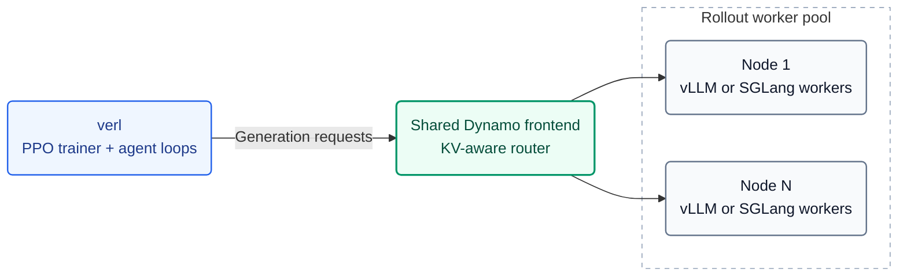

# Dynamo rollout backend for verl

Run verl training with **vLLM or SGLang** behind Dynamo's **KV-aware router**.
The recipe supports shared or separate training/rollout GPUs, weight updates,
and engine sleep/wake. All training launchers use `verl.trainer.main_ppo`.

[Architecture](#architecture) · [Quick start](#quick-start) ·
[Configuration](#configuration) · [Results](#results) · [Key files](#key-files)

## Architecture



**One frontend per rollout pool, shared across nodes and replicas.** Ray manages
one server actor per node; only the pool's first node starts the frontend,
etcd and NATS. Workers publish KV-cache events for routing. Weight updates use
node-local CUDA IPC; separate pools receive weights through verl's checkpoint
engine before applying them locally.

## Quick start

### Required versions

The current **Uni-Agent + Rust ThunderAgent + V1 async** preset was validated
with this stack:

| Component | Version |
| --- | --- |
| Python | 3.12 |
| verl | Unmodified 0.10.0.dev0 from the pinned uv image |
| Uni-Agent | [PR #270 revision](requirements-uniagent.txt) |
| Dynamo | 1.6.0, [b1429b8](https://github.com/ai-dynamo/dynamo/commit/b1429b8bf67a47f4657fb716b2fab369c172f5e5), including the builtin Rust ThunderAgent plugin |
| Inference engine | vLLM 0.29.0 |
| Training stack | PyTorch 2.13.0+cu130; Transformers 5.12.1 |
| V1 trainer | TransferQueue 0.1.11; CuPy matching CUDA for separate-pool NCCL weight synchronization |

Use the pinned image and launch commands in the [usage guide](THUNDERAGENT_VLLM.md). One
[YAML preset](config/dynamo_uniagent_vllm.yaml) owns the defaults; choose
`uniagent_mode=colocate` (8 shared GPUs) or `uniagent_mode=separate` (8+8 GPUs).
Both modes completed two-step H100 RL validation. The [earlier engine benchmarks](#results)
used verl [6cbca9ce](REQUIRED_VERL.txt), Dynamo `8c5a737`, vLLM 0.28.0 or
SGLang 0.5.19, and TransferQueue 0.1.9. Use separate environments for the two
engines; those benchmark results describe their recorded stack.

### Install Dynamo

Prepare the image environment from the [ThunderAgent guide](THUNDERAGENT_VLLM.md#environment),
then install matching Dynamo Python and Rust wheels using the
[installation guide](INSTALL.md). It pins the native ThunderAgent build and
documents the source-build prerequisites and features.

Run training from the verl checkout with this repository at `recipe/`. Keep
`etcd` and `nats-server` on `PATH`; for SGLang, unset `PYTORCH_CUDA_ALLOC_CONF`
and `PYTORCH_ALLOC_CONF`.

### Launch

Choose a preset and supply your model, datasets, and resource overrides:

```bash
export VERL_USE_EXTERNAL_MODULES=recipe.dynamo.register
python3 -m verl.trainer.main_ppo \
    --config-path ../../recipe/dynamo/config \
    --config-name dynamo_trainer_v1_colocate_sglang \
    actor_rollout_ref.model.path=/path/to/model \
    data.train_files=/path/to/train.parquet \
    data.val_files=/path/to/val.parquet \
    trainer.n_gpus_per_node=1 trainer.nnodes=1
```

| Preset | Trainer / placement |
| --- | --- |
| [dynamo_trainer_v1_colocate](config/dynamo_trainer_v1_colocate.yaml) | V1, vLLM, shared GPUs |
| [dynamo_trainer_v1_colocate_sglang](config/dynamo_trainer_v1_colocate_sglang.yaml) | V1, SGLang, shared GPUs |
| [dynamo_trainer_v1_separate](config/dynamo_trainer_v1_separate.yaml) | V1, separate rollout pool; vLLM by default |
| [dynamo_trainer](config/dynamo_trainer.yaml) | Legacy V0, shared GPUs |

For a small training smoke, set `MODEL_PATH`, `TRAIN_FILE` and `TEST_FILE`, then
choose one launcher. Colocate defaults to 1 GPU; separate needs at least 2:

| Placement | vLLM | SGLang |
| --- | --- | --- |
| Shared GPUs | [Colocate smoke](tests/smoke/smoke_dynamo_v1_colocate.sh) | [Colocate smoke](tests/smoke/smoke_dynamo_v1_colocate_sglang.sh) |
| Separate pools | [Separate smoke](tests/smoke/smoke_dynamo_v1_separate.sh) | [Separate smoke](tests/smoke/smoke_dynamo_v1_separate_sglang.sh) |

```bash
TOTAL_STEPS=2 bash recipe/dynamo/tests/smoke/smoke_dynamo_v1_colocate_sglang.sh
```

The SGLang launchers include its required engine and sleep-mode settings.
The separate launchers also set the rollout pool size and batch constraints.
For 30B examples, see the [vLLM launcher](train_30b_rl_dynamo_kv_metrics.sh) and
[SGLang Slurm launcher](train_qwen3_30b_sglang.sh); adapt paths and cluster resources.

## Configuration

Dynamo options live under `actor_rollout_ref.rollout.engine_kwargs.dynamo`.
The shared defaults are in [dynamo_base.yaml](config/dynamo_base.yaml).

| Option | Purpose |
| --- | --- |
| `engine` | `vllm` or `sglang`; keep `rollout.name=dynamo` for both |
| `router_mode` | `kv`, `round-robin`, `random`, or `least-loaded` |
| `enable_kv_events` | Keep `true` for KV-aware routing |
| `thunderagent.enabled` | `false` for the built-in KV router; V1 presets set this explicitly |
| `request_completion_token_ids` | Return exact generated token IDs for RL |
| `enable_worker_system_metrics` | Required for SGLang's native control routes |
| `free_engine_on_train` | Must match `rollout.free_cache_engine` |

- **V1:** keep `agent.agent_loop_manager_class=null` to use TransferQueue.
  Current Uni-Agent instead uses the [Gateway adapter](uniagent_gateway.py).
  The legacy `DynamoAgentLoopManager` only supports V0.
- **Rewards:** use `reward.custom_reward_function.*` with either trainer.
- **Multiple nodes:** presets forward the registry through Ray's runtime environment;
  scripts also forward extra modules from the driver. Set paths and engine
  environment variables on every node before starting Ray.
- **Optional extensions:** [UniAgent variants](run_uniagent_variant.sh) cover
  ThunderAgent and native baselines; [NIXL smoke](tests/smoke/run_nixl_smoke.sh) and
  [bandwidth probe](benchmarks/nixl_bench.py) cover checkpoint-engine weight transfer.

### Enable ThunderAgent

Set `thunderagent.enabled=true` on a Dynamo launcher. For a vLLM V1 smoke:

```bash
bash recipe/dynamo/tests/smoke/smoke_dynamo_v1_colocate.sh \
    ++actor_rollout_ref.rollout.engine_kwargs.dynamo.thunderagent.enabled=true
```

For the UniAgent workload used in the results below:

```bash
VARIANT=ta RAY_DATA_HOME=/path/to/verl-data bash recipe/dynamo/run_uniagent_variant.sh
```

Use `VARIANT=dynamo` for the built-in KV-router baseline or `VARIANT=global`
for native verl vLLM. V1 supports ThunderAgent in `colocate_async` and
`separate_async`. ThunderAgent GPU validation covers vLLM; the Uni-Agent Gateway
adapter accepts `engine: sglang` (tool parsing follows the engine), but its
SGLang GPU validation is still pending.

`thunderagent.enabled=true` launches Dynamo's Python ThunderAgent prototype as a
separate router process. With a Dynamo that ships the builtin plugin (main since
2026-09-23), set `thunderagent.native=true` as well: the recipe keeps
`router_mode=kv` and passes the plugin's policy file as `--router-policy-config`,
so programs are scheduled inside the KV router with no extra process; admission
parameters go under `thunderagent.native_parameters`. The startup probe retries a
404 from the completions route for `thunderagent.health_probe_timeout_s` (default 60).

The [Uni-Agent launcher](run_uniagent_thunderagent_vllm.sh) defaults to Rust
ThunderAgent (`native: true`, `router_mode: kv`, `auto_finalize: false`). The
Gateway releases programs on session completion or abort. Calls within one
program are serial; independent programs run concurrently.

With the prepared vLLM 0.29 image and its bundled verl, the pinned Uni-Agent below,
and a Dynamo build containing the Rust TA plugin:

```bash
export VERL_SRC=/path/to/verl  # this repository is available at $VERL_SRC/recipe
export MODEL_PATH=/models/Qwen3-Coder-30B-A3B-Instruct
export TRAIN_FILE=/data/train.parquet
export TASK_CONFIG=/data/task_config_claude_code.yaml
bash "$VERL_SRC/recipe/dynamo/run_uniagent_thunderagent_vllm.sh"

# Separate pools: first start a 16-GPU Ray cluster, then select the mode.
export RAY_CLUSTER_ADDRESS=10.0.0.1:6379
bash "$VERL_SRC/recipe/dynamo/run_uniagent_thunderagent_vllm.sh" uniagent_mode=separate
```

The [fully async launcher](run_uniagent_thunderagent_vllm_fully_async.sh) is a short
alias for the second command.
`UNIAGENT_ROOT` and `DYNAMO_SRC` are optional source overrides; installed packages
are sufficient. Model/data/task paths and cluster allocation remain workload
specific. Batch sizes, parallelism, KV routing, TA lifecycle, Gateway settings,
logging and output paths have defaults in YAML. The default run is a two-step
smoke; append `trainer.total_training_steps=40` for a longer run. See the
[guide](THUNDERAGENT_VLLM.md) for dependencies, task setup and overrides.

### Subagent programs (Claude Code)

Use the Uni-Agent [PR #270](https://github.com/verl-project/uni-agent/pull/270)
revision pinned in [requirements-uniagent.txt](requirements-uniagent.txt).
For the vLLM 0.29 preset, use the image's bundled verl 0.10.0.dev0 as described
in the [environment guide](THUNDERAGENT_VLLM.md#environment). Install the
matching training and inference dependencies, then run from the verl checkout
with this repository available as `recipe/`:

```bash
python -m pip install --no-deps -r recipe/dynamo/requirements-uniagent.txt
export VERL_USE_EXTERNAL_MODULES=recipe.dynamo.register
```

Remove older `UNIAGENT_ROOT` or `PYTHONPATH` overrides, or point them to the same
revision. Uni-Agent parses agent identity, isolates identical sibling requests,
and stores `extra_fields["agent_context"]` on trajectories. The recipe maps that
context to `<rollout id>/main` and `<rollout id>/agent/<escaped agent id>`; direct
children point to main, and nested children retain their explicit parent.
The outer rollout ID remains the frontend routing key.

Merge the following into the existing training configuration:

```yaml
actor_rollout_ref:
  rollout:
    name: dynamo
    agent:
      agent_loop_manager_class: recipe.dynamo.uniagent_gateway.DynamoAgentFrameworkRolloutAdapter
    engine_kwargs:
      dynamo:
        engine: sglang  # vllm is also supported
        router_mode: kv
        thunderagent:
          enabled: true
          native: true
          auto_finalize: false
          subagent_programs: tree
    custom:
      agent_framework:
        agent_runners:
          task:
            runner_fqn: uni_agent.framework.task_runner.run_task
            trajectory_selection: all
```

Keep the workload's model, datasets, reward and sandbox settings. Select
`trajectory_selection: longest` to follow the upstream Claude RL example;
`all` retains every agent chain. For ablations, `subagent_programs: isolated`
omits parent routing metadata, and `off` shares one TA program across agents;
trajectory identity remains separate in both modes. Set `thunderagent.enabled: false`
to use the same adapter with the upstream Gateway and no TA lifecycle.

In the Uni-Agent task YAML, enable subagents:

```yaml
agent:
  name: claude_code
  enable_subagents: true
```

To release an individual subagent program when it stops, optionally put
[claude_lifecycle_hook.py](claude_lifecycle_hook.py) in the sandbox and merge the
following into the task's `agent` settings. If `--settings` already exists, merge
its JSON instead of passing the argument twice:

```yaml
  extra_args:
    - --settings
    - >-
      {"hooks":{"SubagentStop":[{"hooks":[{"type":"command","command":"python /opt/dynamo-hooks/claude_lifecycle_hook.py","timeout":600}]}]}}
```

For Docker, append these entries to `sandbox.sandbox_kwargs.run_args`; the source
file must exist on every sandbox host. Other providers can include it in the image:

```yaml
  - -v
  - /absolute/worker/path/claude_lifecycle_hook.py:/opt/dynamo-hooks/claude_lifecycle_hook.py:ro
```

The hook derives the rollout endpoint from `ANTHROPIC_BASE_URL`, with an optional
`DYNAMO_AGENT_EVENT_URL` override. Without the hook, programs close at rollout
finalize/abort. Neither response finish reasons nor a parent's next turn trigger
cleanup. A resumed agent keeps its ID and waits for its own release to settle.
The hook does not release the shared program in `subagent_programs: off` mode.

All three Gateway protocols share generation/cleanup coordination. Abort waits
for generation cancellation before releasing programs. Once generation has ended,
cleanup failures and engine pauses defer release without discarding completed
training trajectories. Exhausted retries remain recorded; a later explicit
finalize/abort retries them, and shutdown reports any unconfirmed programs.
The Gateway actor's `get_cleanup_state()` exposes active programs, pending and
exhausted cleanup entries, and releases still running.

## Results

### Qwen3-30B-A3B-Base · ReTool · 8×H100

V0 GRPO on one 8×H100 80GB node per arm, with two TP4 replicas. Dynamo uses
KV-aware routing, KV events enabled, and ThunderAgent disabled. This comparison
uses **steps 1–30** of each independent 50-step run.

Lower is better. These are all 30 raw logged steps, including step 1.

| Arm | Mean timing_per_token_ms/gen | Mean vs. native |
| --- | ---: | ---: |
| Dynamo + vLLM | 0.23511 | −5.63% |
| Native vLLM | 0.24915 | baseline |
| Dynamo + SGLang | 0.26091 | −3.66% |
| Native SGLang | 0.27082 | baseline |

Means are in ms/token, with equal weight per step and no W&B smoothing.
This metric includes tool-return context tokens. These runs used additional
verl/data/tool preparations; evolving policies and sparse tool use limit
conclusions about KV routing alone. See the [benchmark report](https://github.com/verl-project/verl-recipe/blob/5451026758c3f1dc3ebc2a46a0e52b14406f0f72/dynamo/benchmarks/retool_h100_20260916.md)
for the setup, W&B links, metric definitions and full 50-step results.

### ThunderAgent · UniAgent · 8×H20-3e

Qwen3-Coder-30B-A3B-Instruct on 8×H20-3e (140.4 GiB/GPU), with two TP4 replicas
and colocated, synchronous GRPO. The comparison is Dynamo ThunderAgent versus
verl's native Global LB on vLLM.

| Concurrency | Rollout-phase speedup | Full-step speedup |
| ---: | ---: | ---: |
| 384 | 1.94× | 1.39× |
| 512 | 2.40× | 1.60× |

At concurrency 64–256, performance was near parity. Rollout throughput counts
model-generated tokens per rollout second; full-step measurements also include
reward/advantage computation, log-probability evaluation, actor updates and
weight synchronization.

### Entry-point validation

The subsequent `main_ppo` entry-point cleanup passed **141 CPU tests per engine**
and **6 native CLI configuration checks**. GPU training was not repeated for that cleanup.

The [current Uni-Agent Rust TA preset](THUNDERAGENT_VLLM.md) was separately
validated on 2026-10-19 with vLLM 0.29: both colocate (8 H100) and separate
(8+8 H100) entry points completed two training steps and exited successfully.

## Key files

| File | Role |
| --- | --- |
| [register.py](register.py) | Register the Dynamo backend with verl |
| [config/](config/) | V0/V1 presets and shared defaults |
| [run_uniagent_thunderagent_vllm.sh](run_uniagent_thunderagent_vllm.sh) | Uni-Agent + Rust ThunderAgent entry point, validated with vLLM 0.29 |
| [THUNDERAGENT_VLLM.md](THUNDERAGENT_VLLM.md) | Pinned environment, Claude Code task setup and colocate/separate launch instructions |
| [dynamo_async_server.py](dynamo_async_server.py) | Shared frontend, worker pool and lifecycle |
| [dynamo_rollout.py](dynamo_rollout.py) | Select the vLLM or SGLang adapter |
| [dynamo_agent_loop.py](dynamo_agent_loop.py) | Agent-loop clients and async integration |
| [uniagent_gateway.py](uniagent_gateway.py) | Current Uni-Agent Gateway and ThunderAgent program lifecycle |
| [tests/](tests/) | CPU regression tests, GPU smokes and validation scripts |
